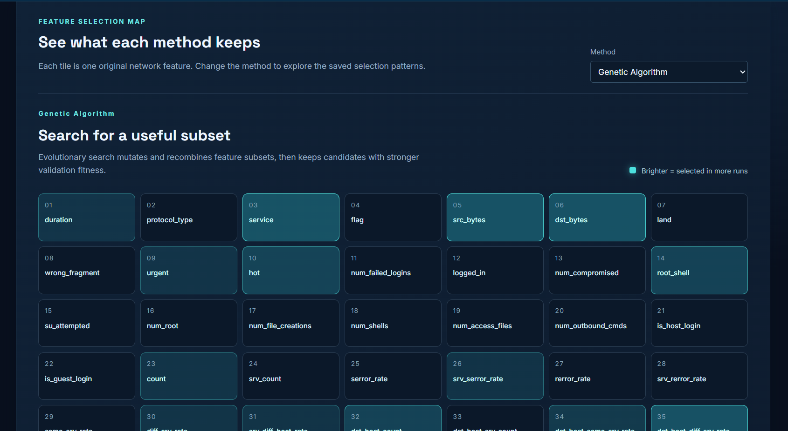
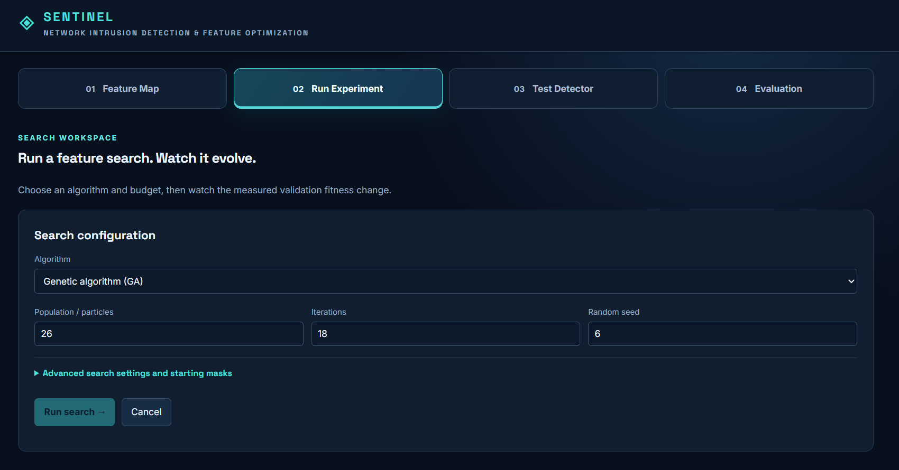
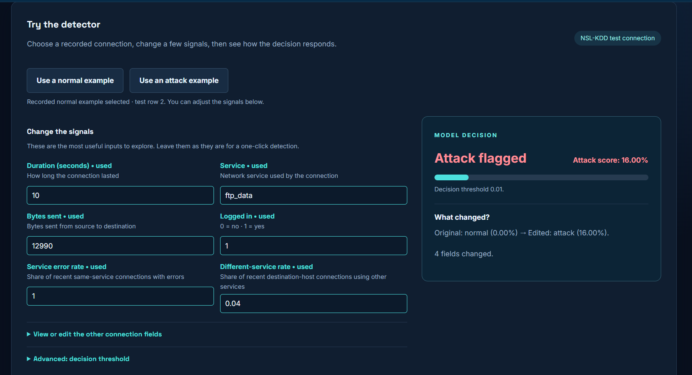

# Sentinel

### Network intrusion detection & feature optimization · NSL-KDD

A local Flask workbench for exploring how **genetic algorithms (GA)** and **binary particle swarm optimization (PSO)** select compact feature sets for a Random Forest intrusion detector. Use the interface to inspect the selected inputs, run a new search, test a saved detector on recorded connections, and examine its evaluation.

> **Dataset scope:** This is an NSL-KDD research demonstration using structured connection records. It does not capture live network packets or validate a deployment on modern traffic.

<p align="center"></p>

## Explore the workbench

| Tab | What it does |
| --- | --- |
| **01 · Feature Map** | Browse all 41 original inputs and see how often GA, PSO, chi-square, or the full-input baseline selected each one in the saved study. |
| **02 · Run Experiment** | Configure and run one GA or PSO feature search. Watch validation fitness, recall, and feature selection change by iteration. Optional starting masks let you propose candidate subsets. |
| **03 · Test Detector** | Load a normal or attack example from NSL-KDD, edit connection values, and classify it with an available saved Random Forest. Expand the optional replay, what-if comparison, and analyst challenge. |
| **04 · Evaluation** | Inspect the selected detector's saved measurements, confusion matrix, selected features, attack-type breakdown, and feature-selection frequencies. Export the model listing as CSV. |

<table><tr><td width="50%"></td><td width="50%"></td></tr></table>

*Screenshots show example runs. A new search does not automatically replace the saved detector. Edited connections are hypothetical scenarios with no verified ground-truth label.*

## Run locally

**Requirements:** Python 3.11 and the two NSL-KDD files included in [`data/`](data). Node.js 22 is needed only for the optional frontend tests. The frontend is served by Flask; there is no separate frontend server or npm install step.

### Windows PowerShell

```powershell
py -3.11 -m venv .venv
.\.venv\Scripts\python.exe -m pip install -r requirements.txt
.\.venv\Scripts\python.exe bootstrap_demo.py
.\.venv\Scripts\python.exe app.py
```

If you already created `venv` rather than `.venv`, use `venv\Scripts\python.exe` in those commands. If `py -3.11` says no suitable runtime was found, install Python 3.11 first and reopen PowerShell.

### macOS / Linux

```sh
python3.11 -m venv .venv
.venv/bin/python -m pip install -r requirements.txt
.venv/bin/python bootstrap_demo.py
.venv/bin/python app.py
```

Open **http://127.0.0.1:5000**. Press `Ctrl+C` in the terminal to stop the server. The first bootstrap trains a local Random Forest and may take a while; later runs reuse that available local model. `GET /api/default-detector` reports whether the chosen model can actually be loaded.

### Why bootstrap is required

The historical calibrated detector's report and metadata are published, but its original `.joblib` model binary and `.npz` prediction cache are **not** in this repository. A fresh checkout therefore cannot load that exact binary. `bootstrap_demo.py` verifies the committed dataset, trains a **new locally identified demonstration detector** using the recorded 11-feature subset and configuration, and saves the new artifacts on your computer. It does not restore or relabel the historical model. If no model is available, the UI still opens and explains what must be done; predictions remain unavailable until a model is trained or restored.

The recorded historical PSO configuration (seed 3, 11 original inputs, threshold 0.01) measured **92.47% accuracy, 94.51% attack recall, 93.46% F1, and 10.23% false-alarm rate** on `KDDTest+`. These numbers describe that *specific recorded detector*, not every GA/PSO run or the newly generated binary. The original selection was exploratory after prior test-set inspection. See [`FINAL_DETECTOR.md`](FINAL_DETECTOR.md) for the selection rule and provenance.

If you have the **original** `models/99af1769fd4d4e0a831a0bd435890d60.joblib`, its matching `.predictions.npz`, and `results/prepared_data.joblib`, place them at those exact paths and run `python activate_detector.py` with your environment's Python. The activation script checks the original artifacts before making the historical calibrated detector available. Only load joblib files from a trusted source.

## How the search works

1. Split `KDDTrain+` into a stratified training and validation portion; reserve `KDDTest+` for final evaluation. Turn attack names into an attack/normal target and one-hot encode `protocol_type`, `service`, and `flag`.
2. Represent a feature subset as a **41-bit mask**, one switch per original input. A categorical switch includes or excludes all of its encoded columns together.
3. Generate candidate masks with GA (selection, crossover, mutation) or binary PSO (personal best, swarm best, sigmoid sampling). A grouped chi-square top-12 subset and all 41 inputs provide comparison baselines.
4. Score each mask by fitting a Random Forest on search-training rows and measuring predictions on validation rows. Fitness combines predictive quality, selected-feature count, and configured constraints; lower is better.
5. Refit a final forest on all of `KDDTrain+` only after selecting a subset. Evaluate it on `KDDTest+` and save the model and report separately from the search history.

The **Run Experiment** tab starts one new search using its displayed seed and settings; it is distinct from the recorded five-seed comparison and the historical validation calibration. Consult [`REVISION_STEPS.md`](REVISION_STEPS.md) and [`FINAL_DETECTOR.md`](FINAL_DETECTOR.md) for the recorded research methodology.

## Check the application

```sh
node --check static/app.js
node --test tests/frontend.test.cjs
python -m unittest discover -s tests -v
```

Run the Python command with the same virtual environment used above. The checks cover the main UI controls and Flask workflows including startup without a model, prediction, replay, what-if, challenge, and search. GitHub Actions runs them on pushes and pull requests.

## Project layout

```text
app.py                 Flask pages and JSON API routes
bootstrap_demo.py      Fresh-checkout demonstration-model training
src/preprocess.py      Dataset split, encoding, original-feature mapping
src/ga.py / src/pso.py  Candidate-subset search
src/fitness.py         Random Forest validation scoring
src/baselines.py       Full-input and grouped chi-square baselines
src/service.py         Jobs, saved models, prediction workflows
templates/index.html   Four-tab interface
static/app.js           Browser interactions and API calls
static/style.css        Visual system
results/               Recorded reports and local job outputs
models/                Metadata; local model binaries are not committed
```

The backend also provides JSON routes such as `/api/run`, `/api/status/<id>`, `/api/classify`, `/api/what-if`, and `/api/results`. The browser calls these routes on the same Flask origin.
